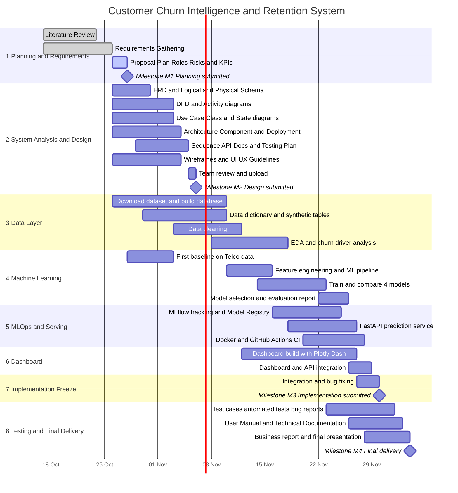

# Project Plan: Customer Churn Intelligence & Retention System

| Item | Detail |
|---|---|
| Program | AI & Data Science, Data Scientist track (IBM / DEPI) |
| Team size | 6 members |
| Project start | 17 Oct 2026 |
| Final delivery | 4 Dec 2026 |
| Repository | `churn-intelligence-platform` (GitHub) |
| Version | 1.1 (updated 26 Oct 2026) |

---

## 1. Timeline (Gantt Chart)

---

## 2. Milestones

| ID | Milestone | Date | Exit criteria |
|---|---|---|---|
| M1 | Planning, Literature Review, Requirements | 16 Oct 2026 | All documents in `docs/01-planning`, `docs/02-literature`, `docs/03-requirements` and pushed to GitHub |
| M2 | System Analysis & Design | 6 Nov 2026 | All UML, ERD, DFD, architecture, wireframes, deployment diagrams, API documentation and testing plan in `docs/04-design` |
| M3 | Implementation | 30 Nov 2026 | Database, ML pipeline, dashboard working from the README; MLflow, API, Docker and CI working if the extensions are completed |
| M4 | Final Presentation, Testing, Reports | 4 Dec 2026 | Test report, user manual, technical documentation, business report and slides delivered |

> M1 was originally due on 16 Oct 2026. The 28 Oct date assumes that late submission is accepted by the lecturer.

---

## 3. Deliverables per Phase

| Phase | Deliverables |
|---|---|
| Planning & Management | Project Proposal, Project Plan, Task Assignment & Roles, Risk Assessment & Mitigation, KPIs |
| Literature Review | Review of churn prediction approaches and retention systems; lecturer feedback and improvements (to be completed by the lecturer) |
| Requirements | Stakeholder Analysis, User Stories & Use Cases, Functional and Non-functional Requirements |
| Design | Problem Statement, Use Case, Class, Sequence, Activity and State diagrams, DFD, ERD, Logical & Physical Schema, Software Architecture, Wireframes, UI/UX Guidelines, Technology Stack, Deployment and Component diagrams, API Documentation, Testing & Validation plan, Deployment Strategy |
| Implementation | SQL scripts, data dictionary, cleaning and EDA notebook, ML pipeline, dashboard, README; target extensions: MLflow, FastAPI, Dockerfile, GitHub Actions workflow |
| Testing & QA | Test Plan and Test Cases, automated tests, bug reports |
| Final | User Manual, Technical Documentation, Business Report, Presentation, optional demo video |

---

## 4. Resource Allocation

### 4.1 Team

| Member | Role | Main responsibility |
|---|---|---|
| عبدالله | Data Engineer | Database, SQL scripts, synthetic tables, data dictionary |
| مريم | Data Analyst | Cleaning, EDA, feature engineering, data-flow documentation |
| محمد | ML Engineer | Model training, comparison, evaluation and selection |
| مصطفى | MLOps Engineer | MLflow, FastAPI, Docker, GitHub Actions, deployment, testing plan |
| بسمله | Dashboard / Frontend | Plotly Dash dashboard, wireframes, UI/UX, user manual |
| بثينه | Business Analyst | Business problem, KPIs, stakeholders, requirements, risks, recommendations, report |

The full responsibility matrix is in `task-assignment.md`.

### 4.2 Workload by Phase (primary owner and support)

| Phase | Primary | Support |
|---|---|---|
| Planning | بثينه | All members |
| Requirements | بثينه | محمد, مريم |
| Design: data | عبدالله | مريم |
| Design: architecture, API, testing | مصطفى | محمد |
| Design: UML | محمد, بثينه | مريم |
| Design: UI | بسمله | بثينه |
| Data layer | عبدالله, مريم | محمد |
| Machine learning | محمد | مريم |
| MLOps and serving | مصطفى | محمد |
| Dashboard | بسمله | بثينه |
| Testing | مصطفى | All members |
| Final report and presentation | بثينه | All members |

### 4.3 Tools and Technology

| Area | Tools |
|---|---|
| Language | Python 3.11 |
| Data | SQLite or PostgreSQL, Pandas, NumPy |
| Visualization | Matplotlib, Seaborn, Plotly, Dash |
| Machine learning | scikit-learn |
| MLOps (target extensions) | MLflow, FastAPI, Docker, GitHub Actions |
| Collaboration | GitHub (feature branching and pull requests), Jupyter |
| Deployment (target) | Hugging Face Spaces; local Docker is the minimum |

---

## 5. Key Dependencies

1. The database schema (ERD) must be stable before the SQL scripts and cleaning are finalized.
2. The cleaned dataset is required before model training.
3. A selected model must exist before registering it in MLflow and exposing it through the API.
4. The API contract (`POST /predict`) is agreed early so the dashboard can integrate with it.
5. The core deliverables (database, analysis, models, dashboard, report) are completed before the optional MLOps extensions take team time.

---

## 6. Team Working Agreement

- Each member works on a feature branch and opens a pull request into `main`.
- At least one teammate reviews every pull request before merging.
- A short weekly sync reviews progress against this plan.
- Any delay of more than 2 days is reported to the project lead and recorded in the risk register.

---

## 7. Assumptions

- Late submission of the planning documents is accepted by the lecturer.
- The IBM Telco Customer Churn dataset is used, with additional relational tables generated synthetically and documented as such.
- The Grading Criteria are still to be confirmed with the lecturer and may adjust priorities.
- Dates for the Data, Machine Learning, MLOps and Dashboard sections are estimates that the team reviews at each weekly sync.
